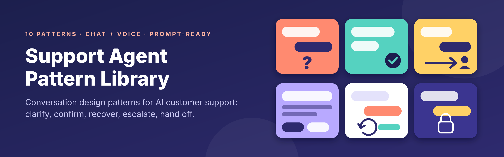

<p align="center"></p>

# Support Agent Pattern Library: Conversation Design Patterns for AI Customer Support Agents

**[Live pattern library](https://jkelleman.github.io/support-agent-pattern-library/)**: browse all ten patterns and assemble a system prompt from their fragments.


[](https://github.com/jkelleman/support-agent-pattern-library/actions/workflows/validate.yml)


[](LICENSE)
[](https://github.com/jkelleman)

Reusable conversation patterns for an AI customer-support agent at a global streaming service. Each pattern covers when to use it, how the turns go, a good and a bad example, how it fails in production, how to measure it, and the prompt text an engineer can ship.

> Independent portfolio project by [Jen Kelleman](https://github.com/jkelleman). Not affiliated with or endorsed by Netflix. All examples, prices, and error codes are illustrative.

---

## Why this exists

A virtual support agent is only as consistent as the patterns behind it. Without shared patterns, every new intent gets designed from scratch, tone drifts between flows, and the same failures (re-asking for information, refusing to hand off, inventing policy) show up again and again.

This library treats conversation design like a design system:

- **Designers** write and review patterns in plain markdown.
- **Engineers** read `patterns.yaml` and paste prompt fragments into the system prompt.
- **Eval pipelines** map each pattern to rubric criteria, so a prompt change can be tested against the behavior it's supposed to produce.
- **CI** (`scripts/validate_patterns.py`) fails the build if a pattern is missing a required section or drifts out of the registry.

## The patterns

| Pattern | Category | Risk | What it prevents |
|---|---|---|---|
| [Clarify an ambiguous intent](patterns/clarify-ambiguous-intent.md) | Understanding | Low | Guessing wrong, or endless "can you tell me more?" loops |
| [Carry context across turns and sessions](patterns/context-carryover.md) | Understanding | Medium | Making members repeat themselves |
| [Lead with a known issue](patterns/proactive-known-issue.md) | Understanding | Medium | Sending millions to restart routers during an outage |
| [Confirm before a consequential action](patterns/confirm-before-action.md) | Action | High | Plan or billing changes the member didn't understand |
| [Verify before sharing sensitive info](patterns/verify-before-sensitive-info.md) | Action | High | Account takeover through the support channel |
| [Respectful cancellation](patterns/respectful-cancellation.md) | Action | High | Dark-pattern retention mazes |
| [Recover from a misunderstanding](patterns/recover-from-misunderstanding.md) | Recovery | Medium | "Let's start over" |
| [Say "I don't know" gracefully](patterns/graceful-no-answer.md) | Recovery | High | Confident, made-up answers |
| [Decide when to escalate](patterns/escalate-to-human.md) | Handoff | High | Members fighting to reach a person |
| [Warm handoff with summary](patterns/warm-handoff.md) | Handoff | Medium | Human agents starting from zero |

Start with [docs/principles.md](docs/principles.md): five principles that decide what to do when patterns conflict.

## Anatomy of a pattern

Every pattern has the same eight sections, enforced by CI:

```
When to use      → the trigger, and when NOT to use it
Member need      → one sentence in the member's voice
Turn structure   → the steps the agent follows
Example          → a realistic exchange (plus a voice variant where needed)
Anti-pattern     → a realistic bad version and why it fails
Failure modes    → what goes wrong in production, the log signal, the fix
Measure it       → metrics with targets
Prompt fragment  → shippable instruction text
```

The **failure modes** and **measure it** sections matter most. A pattern that doesn't say how it breaks or how you'd know can't be improved after launch.

## Repo layout

```
patterns/                 one markdown file per pattern
patterns.yaml             registry for engineers and eval pipelines
docs/principles.md        the five principles + writing rules
prompts/                  how fragments assemble into a system prompt
templates/                template for new patterns
scripts/validate_patterns.py   CI check
```

## Run the validator

```bash
pip install pyyaml
python scripts/validate_patterns.py
# OK: 10 patterns, all sections present, registry in sync
```

## How this connects to a streaming support org

Streaming support has a specific shape that these patterns are built around:

- **Self-service first.** Netflix's Contact Engineering team describes the help center as the first line of support for members around the world, and says it's working toward a personalized help platform that uses streaming signals to resolve errors proactively ([source](https://sites.google.com/netflix.com/contact-engineering)). `proactive-known-issue` and `context-carryover` are the conversation side of that: use the signals before asking the member anything.
- **Live events change the load.** A live event can send millions of members to support at once, all with the same problem. The companion repo [live-event-surge-playbook](https://github.com/jkelleman/live-event-surge-playbook) shows how these patterns change under surge.
- **Global by default.** The same pattern has to work in many languages and cultures. See [multilingual-voice-guide](https://github.com/jkelleman/multilingual-voice-guide).
- **Evals, not vibes.** Each pattern's `eval_criteria` maps to the binary rubric in [golden-dataset-kit](https://github.com/jkelleman/golden-dataset-kit).

## Executive summary

**Problem.** AI support agents fail in predictable ways: they guess, repeat questions, invent policy, and resist handing off. Each failure costs a contact, and trust.

**Approach.** A shared library of 10 conversation patterns, each with production failure signals, metrics, and ready-to-ship prompt text, checked in CI and mapped to eval criteria.

**What it enables.**
- New intents are assembled from tested patterns instead of designed from scratch.
- Prompt changes are tested against the specific behaviors they affect.
- Product, engineering, research, and the AI vendor share one definition of "good."

**Metrics to watch.** Repeat-ask rate (target 0), asks-before-transfer (target 1), grounding rate on policy/price claims (target 100%), containment *by intent* rather than overall.

## About the author

I'm a conversation and content designer for AI agents. At Microsoft I led the Fabric Unified Error Framework and was principal content designer on an in-product agent experience. I've trained human reviewers and LLM judges to grade AI output consistently. This library brings those practices to customer support.

## License

MIT. See [LICENSE](LICENSE).
